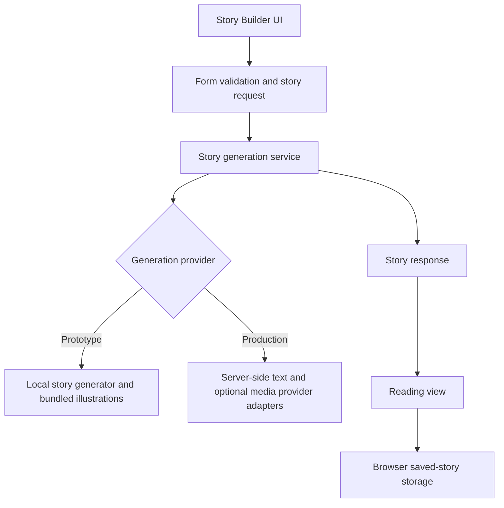

# Storypod Web App: Product and Architecture Plan

**Status:** Proposal  
**Scope:** First usable, mobile-first web application

## 1. Product Summary

Storypod helps a parent or caregiver create a short, personalized bedtime story for a child. The adult chooses a child-friendly character, a setting or theme, and optionally a lesson or mood. Storypod returns a readable story that can be saved, revisited, or read aloud together.

The first release should make the path from opening the app to reading a story feel simple and reassuring. It should work well on a phone, avoid requiring an account to try the core experience, and clearly distinguish generated content from saved stories.

## 2. Goals and Non-Goals

### Goals

- Generate a unique, age-appropriate story from a small set of user inputs.
- Keep story creation quick, approachable, and usable with one hand on mobile.
- Let the adult adjust story length, age range, tone, and optional lesson.
- Provide a pleasant reading view with controls to generate another story or save the current one.
- Keep the generation provider replaceable so the UI does not depend on a particular AI vendor.
- Handle loading, empty, validation, and generation-error states clearly.

### Non-Goals for the First Release

- Child accounts, social sharing, public story feeds, or community content.
- Voice cloning, generated audio, or AI-generated images/video. The first release uses bundled still illustrations; generated video is deferred.
- Subscriptions, payment processing, and paid access tiers are out of scope for the first release and may be considered after launch if there is a validated business need.
- Training or fine-tuning a model on children's personal information.

## 3. Primary User Flow

1. The caregiver opens the Storypod home screen.
2. They enter a child-friendly hero or character, choose a setting/theme, and optionally add a lesson or sidekick.
3. They select an age range and approximate story length.
4. They submit the form and receive clear feedback while the story is generated.
5. The app displays the story in a calm reading view.
6. The caregiver reads it as a sequence of illustrated pages, can move between pages, edit the inputs and try again, or save it to a local library.

The core flow should not require an account. If cloud sync is introduced later, account creation should be optional and separate from story generation.

## 4. UX and Visual Design Direction

- **Mood:** Warm, imaginative, and bedtime-appropriate without becoming visually busy or overly childish.
- **Layout:** Mobile-first single-column story creation, with a persistent, easy-to-find primary action. On wider screens, use a compact form beside or above the story output rather than marketing-style hero content.
- **Typography:** A distinctive, highly legible display face for story titles paired with a readable body face for forms and story text. Load fonts locally or from a controlled provider and define sensible fallbacks.
- **Color:** A balanced night-sky palette with warm light surfaces and a small number of bright accents for focus and actions. Maintain accessible text contrast; do not rely on color alone for status.
- **Controls:** Use labeled text inputs, choice buttons or selects for finite options, and a clear disabled/loading state on generation. Provide visible focus styles and large touch targets.
- **Reading view:** Present the story as a picture-book sequence. Every page pairs a short passage with an illustration or video, with previous/next controls and a clear page counter. Still illustrations are the first-release default; video is an optional visual type. Keep text readable, media appropriately sized, and actions for save and new story unobtrusive.
- **Responsive behavior:** Verify small phones, tablets, and desktop widths. Avoid horizontal overflow and keep the main action reachable on small screens.
- **Motion:** Use brief, reduced-motion-aware transitions when changing from the form to the story. Motion must not delay reading or interaction.

## 5. Proposed Technical Architecture

Start with a small TypeScript web app, organized so the story-generation implementation can be swapped without rewriting the interface.



### Suggested layers

- **Presentation:** Pages and reusable UI components for the story builder, reading view, saved stories, and feedback states.
- **Domain/types:** Typed story inputs, page-based story output, page visuals, age range, tone, and length options. Keep these independent from UI and provider SDKs.
- **Application service:** A `generateStory(input)` interface that validates input, creates ordered story pages, attaches a visual to each page, and returns a normalized story result.
- **Provider adapters:** A local prototype implementation uses bundled still illustrations. Production text and visual generation adapters are separate; any provider calls run on the server so credentials and policy controls are not exposed in the browser.
- **Persistence:** Browser storage for the initial saved-story library. Use a storage wrapper so a server-backed library can replace it later without changing the reading UI.

### Suggested repository organization

```text
src/
  app/                 # App shell and route setup
  components/          # Shared form, navigation, and feedback components
  features/
    story-builder/     # Inputs, validation, and submission state
    story-reader/      # Story presentation and reader actions
    library/           # Saved story list and storage integration
  services/
    stories/           # Generation interface and provider adapters
  types/               # Shared domain types
  styles/              # Global styles, tokens, and responsive rules
```

This is a proposed organization, not a requirement to create every folder before the first vertical slice.

## 6. Story Data Contract

The generation boundary should use a small, provider-independent contract.

### Request

- `mainCharacter`: required, trimmed string with a reasonable maximum length.
- `theme`: required selection or short text with a maximum length.
- `sidekick`: optional short string.
- `lesson`: optional selection or short text.
- `ageRange`: one of the supported age bands.
- `length`: a small enum such as `short`, `medium`, or `long`.
- `tone`: a controlled choice such as `gentle`, `silly`, or `adventurous`.

### Response

- `id`: stable identifier for the story.
- `title`: short display title.
- `pages`: ordered list of story pages.
- Each page has `pageNumber`, `text`, and `visual`.
- `visual` has a `kind` (`image` or `video`), a media `url`, and required `altText`; video may also include a poster image and duration.
- `createdAt`: timestamp.
- `inputs`: normalized request used to create the story.
- `provider`: optional internal provider/version metadata; do not expose secrets.

The UI should render a validated response shape rather than provider-specific output. Every page must have a usable visual; fall back to a bundled illustration if optional media is missing or fails to load. Provider errors should be normalized into actionable, non-technical messages.

## 7. AI Generation and Content Safety

- Keep API keys and provider calls on a server endpoint in any production deployment.
- Validate and bound all user input before generation; do not treat user-provided text as trusted instructions.
- Include age-appropriate generation constraints and disallow frightening, sexual, graphic, discriminatory, or otherwise unsuitable content for children.
- Apply age-appropriate safety checks to generated images and video as well as story text. Do not use a child's photo or likeness as input.
- Treat generated output as untrusted text: render it as text, not executable HTML or Markdown with unsafe embedded content.
- Do not autoplay video with sound. Provide accessible playback controls, a poster image, and text alternatives where needed.
- Provide a retry path for empty, malformed, or rejected outputs and a clear message if generation is temporarily unavailable.
- Avoid collecting a child's full name, birth date, location, school, photos, or other sensitive details. Make personalization work with fictional names and preferences.
- Define retention and deletion behavior before adding server-side story history or analytics. Do not send story inputs to analytics by default.
- Keep a parent/caregiver in control of reading and saving generated stories.

## 8. State and Persistence

The first version can keep transient form and generation state in the client. Saved stories can be stored in browser storage behind a small `StoryRepository` interface.

- Do not persist unsaved inputs unless the user opts in.
- Handle unavailable or full browser storage without blocking story generation.
- Include a delete action for saved stories.
- Treat browser storage as device-local convenience, not secure or cross-device storage.
- Consider cloud persistence only after confirming account, privacy, retention, and deletion requirements.

## 9. Accessibility and Quality Requirements

- Use semantic landmarks, headings, labels, buttons, and form validation messages.
- Announce generation status and errors to assistive technology with an appropriate live region.
- Support keyboard-only use and visible focus.
- Support keyboard-accessible page navigation, announce page changes, and provide meaningful alternative text for page visuals.
- Test image/video loading failures, page order, and navigation; respect reduced-motion preferences and avoid automatic video playback.
- Respect reduced-motion preferences.
- Check color contrast and text resizing.
- Add unit tests for input validation, generation response normalization, and storage behavior.
- Add component or integration tests for the create-to-read flow, error state, and save/delete actions.
- Test the production build and manually inspect narrow and wide layouts.

## 10. Delivery Plan

1. **Foundation:** Confirm the stack, establish the app shell, responsive design tokens, and shared story types.
2. **Story creation:** Build the input form, validation, loading/error states, and a local generation adapter so the end-to-end flow works without credentials.
3. **Reading experience:** Add the story view, regenerate/edit flow, and accessible reading layout.
4. **Saved stories:** Add browser-local save, list, open, and delete behaviors.
5. **Production generation:** Add a server-side provider adapter, secrets configuration, rate limiting, safety handling, and deployment configuration after a provider is selected.
6. **Hardening:** Run automated checks, accessibility review, responsive verification, and privacy review.
7. **Future monetization (optional):** If post-launch usage validates the need, define free and paid entitlements, select a payment provider, and implement subscription lifecycle, billing, cancellation, and support workflows. This is not part of the MVP.

## 11. Decisions to Confirm Before Implementation

- Target: responsive web app / installable PWA, or a native mobile app.
- Preferred frontend framework and deployment host.
- AI provider, model, expected operating cost, and whether production generation is in scope now.
- Whether stories need accounts and cross-device sync, or browser-local saves are sufficient.
- Initial supported languages and age bands.
- Whether read-aloud/audio belongs in the first release.

## 12. Acceptance Criteria for the First Vertical Slice

- A caregiver can provide a character and theme and receive a complete story without an external API key.
- Required inputs are validated and invalid submissions explain what needs attention.
- Generation has visible pending and failure states and does not permit accidental duplicate submissions.
- The generated story is readable as pages on a phone and desktop; each page includes story text and a visual and the story can be regenerated.
- The app does not require sensitive child information or expose provider credentials.
